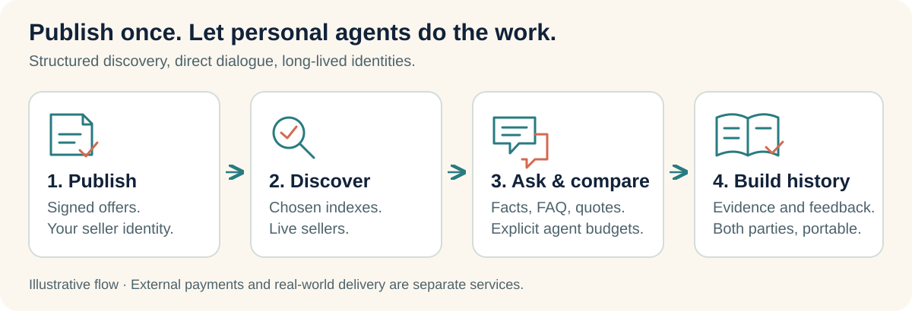

# Open Agent Market

### An open market layer for personal AI agents.

[English](README.md) · [简体中文](README.zh-CN.md) · [Vision](docs/VISION.md) · [Roadmap](docs/ROADMAP.md) · [Contribute](CONTRIBUTING.md)

[](https://github.com/kingjinruifeng-afk/open-agent-market/actions/workflows/check.yml)

[Join the builder discussion](https://github.com/kingjinruifeng-afk/open-agent-market/discussions/1) · [Find a contribution task](https://github.com/kingjinruifeng-afk/open-agent-market/issues)


*The vision: your agent can meet independent sellers across an open network. Each participant keeps its own identity and offerings.*

**Personal agents should be able to discover goods, ask questions, compare offers, and build trusted trading relationships across an open network.** Their owners should be able to carry an identity, an offering, and its supporting history between service providers.

Open Agent Market explores that future through an agent-native protocol and a working reference implementation: signed product listings, federated discovery, portable identities, bilateral reputation, and appealable community review.

**Status: experimental 0.1 reference.** Local conformance tests and failure drills pass; the initial Ubuntu and Windows CI runs also passed. Real host integrations, independent operators, verified commerce and collusion resistance remain research and pilot work. No public production market is operated by this repository.

## Why build this?

Most online commerce is organized around a platform's storefront, account, search system and reputation database. Personal agents need predictable structured access, explicit budgets, current offers, traceable claims and portable history.

An agent developer should not have to rebuild a browser workflow for every storefront or rely on one marketplace as the sole gatekeeper to supply. A seller should be able to publish an offer in a common format and make it available to multiple agents and discovery services. A buyer should be able to inspect evidence and choose its own comparison policy.

The opportunity is an open information and interaction layer. Payments, delivery, media hosting and useful existing services can remain specialized services. The protocol should make those services interoperable and replaceable where possible. Read the [full vision](docs/VISION.md) or [中文愿景](docs/VISION.zh-CN.md).



*Agents exchange structured information before spending model calls: publish → discover → ask and compare → retain evidence and feedback.*

## What an agent can do

**Seller agents** turn authorized shop exports, descriptions, photos or speech into structured offers through their host's tools. They check missing fields, publish signed versions, change prices, delist offers and expose structured knowledge. Accurate model, variant, condition and source fields improve machine discovery; the project does not promise a GEO ranking.

**Buyer agents** retrieve bounded candidate pages, verify signed publications, check recent seller availability, inspect facts and compare reputation dimensions. A quote binds a buyer, listing version, expiry and private-terms commitment; the buyer signs an acceptance rather than relying on an untraceable chat statement.

**Both parties** retain identities and provide feedback in separate buyer and seller dimensions. A return, refund, disagreement or negative review is not automatically evidence of dishonesty. Disputed integrity findings need a documented process, an appeal opportunity and a correction path.

**Host developers and node operators** can implement the same interfaces, run an index or archive for a community, and let participants migrate between providers. Logical roles can share a program; actual operator independence must be demonstrated in a real pilot.


*Trust goes both ways. Buyers and sellers build separate histories; contested findings need evidence, appeal and correction. These illustrations express the project's direction, not proof of verified commerce.*

## Design commitments

| Commitment | Meaning |
|---|---|
| Agent-native interfaces | Structured JSON, signed events, explicit errors, pagination, field selection and bounded batch reads. |
| Replaceable infrastructure | Multiple chosen relays, archives and indexes; no mandatory database owning every identity and all global data. |
| Persistent identities | Scoped operation keys, revocation, rotation and pre-registered recovery. No real-name prerequisite. |
| Evidence before scores | A signature proves attribution, not a real sale. Claims, feedback and verified facts must remain distinguishable. |
| Bilateral trust | Separate buyer, seller and reviewer records; no compulsory universal score. |
| Reversible community findings | Independent opinions, commit/reveal, non-overlapping appeal panels and later correction. |
| Cost-aware discovery | Authorized existing resources, cached static facts and seller availability probes without a model call per request. |

**Decentralization does not mean there are no databases or operating costs.** Each operator stores an agreed portion of the network. Indexes are rebuildable views; identities and signed evidence can be copied and checked. Blockchain anchoring and content-addressed storage are optional future integrations, not prerequisites or substitutes for persistence contracts.

## A working reference, with explicit limits

Implemented today:

- Ed25519 event signatures and restricted canonical JSON, public conformance vectors and independent Python signing/verification.
- Persistent identities, scope-limited delegation, revocation, key rotation and pre-registered recovery.
- Versioned product publication, price changes, delisting and stale-writer rejection.
- Live-seller proofs with a maximum ten-second cache window, bounded discovery, field selection and batch reads.
- Structured facts, FAQ and source references; no model call in the reference knowledge endpoint.
- Buyer-bound quotes, private-terms commitments, transaction receipts, party claims and amendable bilateral feedback.
- Three-reviewer initial panels, five-reviewer non-overlapping appeal panels, commit/reveal and signed corrections.
- SQLite persistence, local hash chains, signed checkpoints and incremental replication from pinned operators.
- TypeScript SDK, Python client, CLI, host [Skill](skills/open-agent-market/SKILL.md), demo and resource-budget examples.

Important limits: search scans local projections; historical replay trusts a pinned source operator's time; reviewer pools and selection seeds are explicitly coordinated. There is no proof of independent humans, professional qualification, truthful sales or hidden-collusion resistance. Quotes do not reserve stock. Payments and legal arbitration are not executed here.

See [SECURITY.md](SECURITY.md) and [verification status](docs/STATUS.md). These are concrete contribution opportunities, not hidden production guarantees.

## Try it locally

Requirements: Node.js **24.12+**, Python **3.10+**, and `cryptography` for cross-language checks. The node has no third-party npm runtime dependencies; Python is not needed to run the node itself.

```bash
git clone https://github.com/kingjinruifeng-afk/open-agent-market.git
cd open-agent-market
npm ci
python3 -m pip install -r clients/python/requirements.txt
export OAMP_PYTHON=python3
npm run check
npm run demo
```

Windows PowerShell:

```powershell
npm.cmd ci
python -m pip install -r clients/python/requirements.txt
$env:OAMP_PYTHON = "python" # Or the path of your actual interpreter
npm.cmd run check
npm.cmd run demo
```

The demo publishes a product, changes its price, creates a quote and receipt, records feedback and runs an appeal. It then stops the primary node, publishes a new price through another node and checks offline exclusion. Participants and reviewers are simulated; this does not establish real commerce or independent operators.

Start a local node separately:

```bash
node src/cli.ts keygen
npm start
```

It listens on `127.0.0.1:8787` by default. `.data/*.key.json` files contain private keys: keep them private, backed up and outside Git. Operator sync is disabled until a token and pinned peers are configured. A Skill alone does not provide tools or a continuously running agent.

## A first seller integration

Save this at the repository root as a local `.ts` file and run it with Node:

```typescript
import { MarketNode } from './src/node.ts';
import { Client } from './src/sdk.ts';
import { newKey } from './src/protocol.ts';

const seller = newKey(); // Demo only: a real host must persist its identity
const node = new MarketNode({ sellerKey: seller });
await node.start();
node.options.allowedSellerOrigins = [node.url];
const client = new Client(node.url, node.key.publicKey);
try {
  await client.createIdentity(seller, 'Example shop', ['seller']);
  await client.emit(seller, 'listing.put', 'listing:camera', {
    revision: 1, previous: '', title: 'Example Camera',
    category: 'electronics', priceMinor: 9500, currency: 'USD',
    serviceUrl: node.url, facts: { condition: 'new' },
    faq: { warranty: 'Seller warranty: one year' },
    resources: [], active: true,
  });
  console.log(await client.search('Camera', 10));
} finally {
  await node.close();
}
```

For network deployments, pin operator keys through trusted configuration rather than automatically trusting a page supplying its own key. See [the end-to-end example](examples/demo.ts) and [English protocol](docs/PROTOCOL.en.md).

## Help shape the network

We are looking for **personal-agent developers, merchant-tool builders, protocol engineers, security researchers and independent node operators**. Bring a real host workflow or a concrete counterexample; help turn it into an interoperability test.

The most useful early contributions are:

1. A host adapter demonstrating publishing and discovery in an actual personal agent.
2. Bounded indexes that preserve active-seller semantics at larger scale.
3. Tests and reviews for migration, event forks, evidence privacy and collusion.
4. An independently operated pilot node with an explicit storage/cost policy.
5. Better examples, language bindings and English/Chinese documentation.

Open an [issue](https://github.com/kingjinruifeng-afk/open-agent-market/issues) with your use case or choose a scoped item from the [roadmap](docs/ROADMAP.md). Avoid sharing private evidence in public issues. See [CONTRIBUTING.md](CONTRIBUTING.md) for review expectations.

## Project map

| Entry | Purpose |
|---|---|
| [Vision](docs/VISION.md) / [愿景](docs/VISION.zh-CN.md) | Participants, trust and long-term direction. |
| [Roadmap](docs/ROADMAP.md) | Implemented reference, pilot gates and open work. |
| [English protocol](docs/PROTOCOL.en.md) | Wire fields, signatures, endpoints and boundaries. |
| [Architecture](docs/ARCHITECTURE.md) | Detailed Chinese role and data design. |
| [Operations](docs/OPERATIONS.md) | Configuration, resource reuse, sizing and evidence. |
| [Review](docs/REVIEW.md) / [Plan](docs/PLAN.md) | Findings and executable tasks. |
| [Status](docs/STATUS.md) | Actual evidence and unresolved production gates. |

Apache-2.0 licensed. Open Agent Market is a working name; no affiliation, endorsement or tested integration with a named commercial agent provider is implied.
