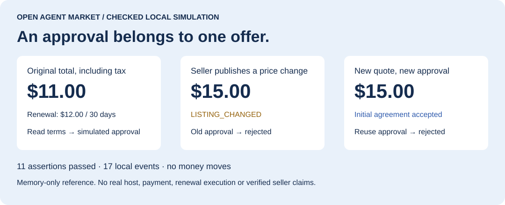

# Open Agent Market

### 在买方 Agent 接受报价前，检查完整条款与确切审批。

[English](README.md) · [简体中文](README.zh-CN.md) · [完整愿景](docs/VISION.zh-CN.md) · [路线图](docs/ROADMAP.md)

面向 **Agent 宿主与商家工具开发者**：用结构化报价、签名事件和本地审批参考，验证一次完整的报价接受流程。

先看一个具体例子：**模拟批准 $11.00 报价后，卖方发布 $15.00 新版本，本地助手拒绝使用旧审批接受旧版本。** 新报价需要重新审阅和批准，过程中没有付款。



## 运行审批演示

需要 Node.js **24.12+**；该演示无需 Python。[PR #6](https://github.com/oldjin-ai/open-agent-market/pull/6) 尚未合并时，使用其分支：

```bash
git clone https://github.com/oldjin-ai/open-agent-market.git
cd open-agent-market
git checkout upgrade/evidence-buyer-approval-20261012
npm ci
npm run demo:buyer-approval
```

预期输出 `PASS`、**17 个本地事件 / 11 项断言**，包含展示快照篡改被拒绝、商品版本变化被拒绝、新报价需新批准、批准只能使用一次。打开生成的 `artifacts/buyer-approval-demo.html` 可回放 40 秒演示；同目录 JSON 报告记录实际断言。[已提交回放页](docs/demos/buyer-approval.html) 也可下载后离线打开。

**这是经过断言检查的本地模拟。** 人工宿主批准为模拟、审批只保存在内存中，没有真实支付、续费/取消执行、人工认证界面或实际宿主接入；商品预检查和接受不是原子操作。[完整边界](docs/BUYER_APPROVAL.md)。

首阶段目标是 **3 位外部开发者复现**，尚无完成记录。欢迎[提交运行结果](https://github.com/oldjin-ai/open-agent-market/issues/new?template=demo-feedback.yml)，只需运行环境、命令和脱敏错误；无需付款或生产接入。主分支尚无表单时，可按[反馈字段](docs/DEMO_FEEDBACK.md)创建普通 Issue。

## 长期方向


*愿景：让你的 Agent 在开放网络中直接发现独立卖家；每一方保有自己的身份、商品信息和经营历史。*

面向个人 Agent 的开放商品发布、检索、交易证据和双向信誉框架。工作名称尚未进行商标或项目名称唯一性核验。当前版本 **0.1 实验参考实现**，适合本地验证和开发宿主适配器。

Agent-native signed listings, portable identities, public receipts, bilateral reputation and appealable community review. No token, blockchain dependency or custodial payments. This repository does not yet operate a public production network.


*发布一次 → Agent 检索在线卖方 → 直接询问与比较 → 双方积累证据和信誉。结构化查询与静态知识优先，模型调用遵循明确预算。*


*信任是双向的：买卖双方分别维护长期信誉；争议需要证据、申诉和更正。插画表达项目愿景，不代表已经完成真实交易验证。*

## 已实现

- Ed25519 签名事件、限定 JSON 规范化；身份、范围授权、撤销、密钥轮换和预登记恢复。
- 商品发布、调价、上下架、前序版本检查；在线卖方短期证明、游标检索、字段选择、批量事件读取。
- 静态商品知识与 FAQ 查询、官网/既有渠道引用，核心流程无需模型。
- 私密条款加盐承诺、外部付款的原生交易记录；双方行为声明与多维度评价分开计算，允许评价修订。
- 3 人初审、5 人不重叠复审、承诺/揭示、申诉期限、更正撤销；社区判责建议不自动执行资金。
- SQLite 持久化、哈希链、签名检查点、固定来源增量复制；TypeScript SDK、独立 Python 签名客户端、宿主 Skill。

当前搜索扫描本站投影，不适合直接承载海量全网搜索；历史同步信任配置的来源运营者的事件时间。匿名身份的独立性、真实交易、评审专业资格均尚未获得生产验证。详见 [安全边界](SECURITY.md)。

2026-10-12增量：`Client.reputation(id, 'evidence-v2')` 显示已接受约定、不同交易对手身份和样本集中程度，明确独立性未验证；旧调用保留兼容字段及弃用说明，评分公式和签名事件不变。多身份不能证明多个独立买家，收货声明不能证明真实履约。

[买方授权参考](docs/BUYER_APPROVAL.md) 检查完整总价、附加购买和续费条款，再要求可信宿主对确切报价进行一次性批准。运行 `npm run demo:buyer-approval`。这是本地模拟，不包含真实人工认证、持久同意记录、累计钱包预算或外部扣款/续费控制。签名键和批准入口必须由宿主隔离，不能作为模型的任意工具。

[试点准备](docs/PILOT.md) 把一个小范围购买比较任务提前验证，记录未知费用、用户纠正、实际成本和再次使用。真实宿主、独立运营者与交易仍待证据；签名使卖方声明可追溯，不保证广告真实。

## 本地运行

需要 Node.js **24.12+**、Python **3.10+** 和 `cryptography`；Python 是跨语言验收依赖，节点运行无需 Python。Node 使用原生 TypeScript 和 SQLite，运行时无第三方 npm 依赖。

```powershell
npm.cmd ci
python -m pip install -r clients/python/requirements.txt
$env:OAMP_PYTHON = "python" # 也可指定真实解释器绝对路径
npm.cmd run check
npm.cmd run demo
npm.cmd run benchmark
node src/cli.ts keygen
$env:OAMP_ADMIN_TOKEN = "本地生成的长随机令牌"
npm.cmd start
```

Linux/macOS 使用 `npm`，环境变量用 `export OAMP_PYTHON=python3`。若未设置解释器，测试尝试 Codex bundled Python，Windows 回退 `py`，其他系统回退 `python3`；缺依赖会明确失败，不静默跳过。

默认只监听 `127.0.0.1:8787`。`GET /.well-known/oamp-node` 查看签名服务声明。生成的 `.data/*.key.json` 包含私钥，应设置本机文件访问权限并备份；Windows 的 POSIX 文件 mode 不等于 ACL。

Demo 使用本机 3 个节点、模拟买卖方和评审身份，生成 `artifacts/demo-report.json` 与加密示例条款。测试另外启动 **3 个独立 OS 进程**验证主节点停止后仍可发布新价格。它们不证明运营者或评审人员的现实独立性。

## 给 Agent 开发者

```typescript
import { Client } from './src/sdk.ts';
import { newKey } from './src/protocol.ts';

const client = new Client('http://127.0.0.1:8787', operatorPublicKey);
const seller = newKey(); // 保存在宿主私密存储；不要每次调用都重建身份
await client.createIdentity(seller, 'My shop', ['seller']);
// 商品发布、报价和签名接受的完整调用见 examples/demo.ts。
const result = await client.search('Camera', 20);
```

`operatorPublicKey` 来自你已信任的运营者配置，不能把陌生网页返回的公钥自动当可信锚。SDK 可校验商品签名与投影，完整授权历史仍须回读事件并由本地领域验证器重放。

宿主加载 [Skill](skills/open-agent-market/SKILL.md)，为其提供 SDK/HTTP 工具、私密存储和签名能力。Skill 是操作说明，单独安装 Markdown 不会自动创建联网工具或持续在线服务。未验证与 Muse、Grok 或其他商业宿主的正式集成。

## 文档

- [复审结论](docs/REVIEW.md)、[优化执行计划](docs/PLAN.md)、[顶层架构](docs/ARCHITECTURE.md)。
- [协议与接口](docs/PROTOCOL.md)、[运营与资源预算](docs/OPERATIONS.md)、[验收状态](docs/STATUS.md)。
- [贡献与版本](CONTRIBUTING.md)、[Apache-2.0 许可证](LICENSE)。

欢迎个人 Agent、商家工具、协议、安全和独立节点开发者参与。优先贡献实际宿主适配、规模化索引、客户端、身份迁移/分叉测试，以及信誉与评审威胁模型。在 Issues 中提供真实场景和可复现问题，不分享私钥、地址或私密交易证据。

已通过的本地检查与仍需真实试点的 Gate 分开记录；发布进度以 docs/STATUS.md 为准。尚未运营正式公共交易服务。
