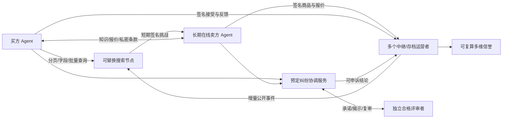

# 顶层架构

## 目标

让个人 Agent 可以绕开封闭信息入口，在开放规范下发布和发现商品、核对知识、建立交易关系、维护长期双向信誉。平台仍可承担支付、物流或详情资源职责；任何单一服务商都不应独占身份、商品权威版本和信誉原始证据。

去中心化指运营者和信任来源可替换、事件可携带并独立核验。它不代表无需服务器、无需数据库、无需存储付费，也不承诺全网即时一致。

## 角色与职责

| 角色 | 职能与权威范围 | 存储 | 主要交互 |
|---|---|---|---|
| 买卖主体 | 持有根身份、授权 Agent、承担承诺 | 根密钥、恢复材料、私密档案 | 授权/撤销/恢复 |
| 卖方 Agent | 结构化商品、价格版本、知识、报价及售后 | 商品权威记录、私密知识 | 发布/修订/回答/报价/行为声明 |
| 买方 Agent | 按需求查询、核验、比较、接受、评价 | 需求、预算、证据、私密条款 | 查询/批量核验/接受/反馈 |
| Agent 宿主/网关 | 长期在线、签名代理、预算、工具适配 | 密钥保险库、运行状态 | SDK/HTTP、宿主原生工具或未来 MCP 适配 |
| 资源提供者 | 官方参数、图片、既有详情、可选镜像 | 自有网站/CDN/对象存储 | 授权链接与检索 |
| 目录节点 | 提供服务地址、能力、运营者信息 | 节点目录 | 静态配置/将来的多源目录发现 |
| 中继节点 | 接收和转发签名增量 | 有限队列/事件缓存 | HTTP 发布、增量拉取、将来订阅 |
| 搜索节点 | 专类/地域索引、分页和候选召回 | 可重建索引 | 结构化查询与签名摘要 |
| 在线检测服务 | 对卖方签名挑战与共享短期证明 | 有上限的短期缓存 | 合并探测、过期剔除 |
| 独立存档服务 | 约定保留、备份、导出与检查点 | 部分公开事件、可选加密证据 | 分页复制、检查点核验 |
| 信誉计算者 | 根据明确版本、范围、来源计算多维事实 | 可重建聚合与来源 | 评分向量、样本/证据/标签查询 |
| 纠纷协调者 | 执行预定策略、排除关系、组织程序 | 案件阶段、签名评审事件 | 分配/通知/揭示/复审/更正 |
| 评审者 | 对证据负责任地签署独立意见 | 私密证据访问记录、签名意见 | 承诺/揭示/利益关系披露 |
| 审计者/协议维护者 | 检查签名、规则、版本与执行证据 | 可复制日志、规范 | 复算/兼容测试/公开变更 |
| 外部支付/物流提供者 | 执行资金与配送，未来签发证明 | 其服务记录 | 用户已有授权下的外部操作 |

同一程序可承担多个逻辑角色。现实独立的运营者才带来故障与控制权分散；多个容器不自动产生独立性。

## 数据归属与保留

| 数据 | 权威来源 | 复制位置与性质 |
|---|---|---|
| 身份及授权 | 主体签名历史 | 多个选择的公开档案；私钥不复制到公共节点 |
| 当前商品/价格 | 卖方签名版本链 | 专类索引与卖方选择的档案 |
| 图文与大量静态详情 | 卖方或授权资源来源 | 官网/CDN/已有渠道；镜像另行约定 |
| 在线证明 | 卖方当前控制键 | 短期缓存；不表示库存已预留 |
| 原生交易记录 | 双方各自签名事件 | 双方和选定公开档案 |
| 地址、会话、付款凭据 | 当事人私密材料 | 本地加密保险库/授权证据服务；只公开加盐承诺 |
| 评价与判责 | 作者或评审的签名意见 | 选定档案；保留原始意见和后续更正 |
| 评分与召回排序 | 指定规则与证据集合 | 任意独立计算者可重建；不是全网唯一值 |

商品离线后退出活跃检索，身份、旧交易和评价仍可按 ID 核验。下架也不删除历史。参考实现保留所有接收事件直到额度耗尽；真实运营须签订保留/删除约定，不能把 GitHub 或 IPFS 当永久免费数据库。

## 交互形态

1. 结构化导入：宿主处理授权文件、照片、语音；草稿检查必填字段，提示来源、型号、单位、条件和适用范围，主体确认后由操作键发布。
2. 供给发布：推送签名事件到选定节点；节点增量拉取并建立限定范围的索引。后续可加分类订阅，避免全网广播所有内容。
3. 发现与核验：买方查询少量候选、检查近期在线证明，按需批量获取原始签名事件。查询返回本站覆盖范围，空结果不代表全网没有商品。
4. 客服：结构化参数和 FAQ 优先，引用来源其次，需解释时才调用卖方宿主模型；模型回复是新声明，不能覆盖签名价格或承诺。
5. 协商与成交：私密商谈 → 绑定特定买方/商品版本/期限/策略的报价 → 买方签名接受。付款与物流在外部执行，接收消息幂等。
6. 售后和反馈：双方各自记录行为；每笔交易每作者每维度仅一个当前评价，可版本化修订。权益行为本身不降低诚信。
7. 争议：客观规则先检验签名、版本、时间和权限；争议事实提交给人确认的独立评审。初审 → 申诉 → 不重叠复审 → 生效 → 新证据更正。
8. 故障与迁移：换运营者、带依赖事件复制、核验本地检查点。版本分叉返回冲突；人工或未来已授权的解决策略追加事件，不能用接收顺序冒充全球真相。

## 信任与激励

信誉显示买卖角色、维度分布、样本量、时间范围、对手方 ID 数、证据类别和案件来源。参考字段 `independentCounterparties` 只表示不同身份 ID，**不证明现实主体独立**。先展示不确定性，再由买方 Agent 按需求设权重；不售卖总分或排名。

初期不以交易分自动产生评审资格。策略明确试点人员池和协调者，3 人初审、5 人复审、5 个新评审可签署撤销更正。种子由协调者提出、结果可复算；不能证明不可操纵的随机性。生产资格须加入专业匹配、关系披露、冷却期、串谋检测、来源证明和退出机制。

贡献仅是已完成评审的试点记录，不通过“与多数一致”奖励，也不因意见被推翻自动惩罚。对恶意退货、退款或差评的严重诚信判断，需要独立支持结论的法定人数、理由与证据引用；不能从退货率/差评率直接推断。外部资金、账户封禁及法律执行属于其他授权和治理系统。

## 扩展与生产演进

协议核心包括信封、授权、版本、收据、来源、程序及错误码。商品、服务和领域策略为版本化能力；住宿日期、地区规则、物流/库存预留和外部证明由扩展定义，不能挤进自由文本绕过必填验证。

存储事件与读投影分离；后续索引用 FTS/专用搜索、存档按类别和时间分片、公共订阅采用 Topic/增量，不要求一个节点保存全网。数据删除/隐私保留与旧签名的兼容、反女巫、随机性、密钥并发轮换、跨节点冲突解决都需先定义规则再进入生产。

区块链可选用于检查点锚定或特定资金系统，大对象可选 IPFS；这两者不会替代检索、在线性、证据真实性和运营承诺。
